<h1 name="user-content-readme-top" align="center">Wiki Plugin for Kanboard</h1>

    
    

    
    
    
    

    
    
    
    

    

---

The main purpose of the Wiki Plugin is to provide an easy way to add and maintain documentation for KB projects:
* Create and manage a branched structure of Wiki pages per project.
* Support for backup of previous versions of Wiki pages as editions.
* Search Wiki pages by title and content across all user accessible projects.
* Wiki pages provide rich text content through the [GitHub Flavored Markdown](https://github.github.com/gfm/), which is implemented by the [parsedown lib](https://github.com/erusev/parsedown).

[<a href="#user-content-readme-bottom">&#8595; Bottom</a>] [<a href="#user-content-readme-top">&#8593; Top</a>]

## Author

* [lastlink](https://github.com/lastlink)
* License [MIT](LICENSE "Read The MIT license")
* Looking for contributors.

[<a href="#user-content-readme-bottom">&#8595; Bottom</a>] [<a href="#user-content-readme-top">&#8593; Top</a>]

## Installation & Compatibility

<strong>Installation</strong>

* Install via the **Kanboard Plugin Directory** or see [**Plugin Installation**](INSTALL.md)
* Read the full [**Changelog**](changelog.md "See changes") to see the latest updates

<strong>Compatibility</strong>

* Requires [Kanboard](https://github.com/kanboard/kanboard "Kanboard - Kanban Project Management Software") ≥`1.0.37`
* **Other Plugins & Action Plugins**
  * _No known issues_
* **Core Files & Templates**
  * `2` Template overrides
  * `3` Database tables serving Wiki plugin purposes + `1` entry into KB settings 

<strong>Translations</strong>

* Available translations for some common languages: `CZ`, `DK`, `DE`, `ES`, `FI`, `FR`, `HU`, `IT`, `JP`, `NO`, `NL`, `PL`, `BR`, `PT`, `RU`, `SE`, `TH`, `TR`, `UA`, `CN`
* _Translation for `en_US` is the default_ if there is no translation pack for the user selected language in KB.

[<a href="#user-content-readme-bottom">&#8595; Bottom</a>] [<a href="#user-content-readme-top">&#8593; Top</a>]

## Features and Usage (with Screenshots)

The Wiki Plugin has three functional views which are explained hereby.

Details on accessing and operating them are provided within each expandable section.

[<a href="#user-content-readme-bottom">&#8595; Bottom</a>] [<a href="#user-content-readme-top">&#8593; Top</a>]

### 🔳 Wiki Content

<strong>Wiki Content Link</strong>

To see the `Wiki Content` for a project simply press the `Wiki` button **[1]** in the project header.
Alternatively, use a keyboard shortcut `v w` while in some of the project views (Overview, Board, List, Calendar).

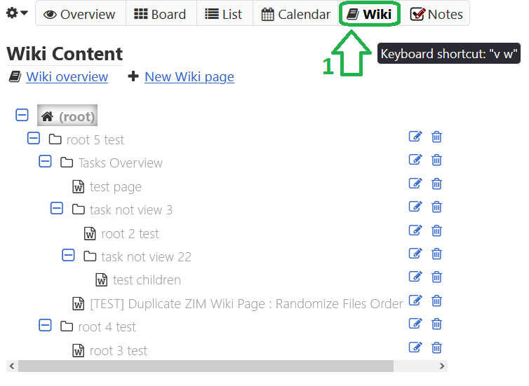

[<a href="#user-content-readme-bottom">&#8595; Bottom</a>] [<a href="#user-content-readme-top">&#8593; Top</a>]

<strong>Wiki Tree View</strong>

The Wiki tree represents the hierarchy of the pages organized in nested branches, starting form an empty `(root)` node.

The interface provides navigation and management functionality as follows:
* the `+` and `-` buttons at the top **[1]** expand and collapse all branches
* the individual branch buttons **[2]** expand/collapse each branch alternatively
* for every page there are `Edit Page` and `Remove Page` buttons **[3]**
* reordering and nesting of individual pages and whole branches **[4]** is available via drag-and-drop within the tree view
* a help button **[5]** to the online README

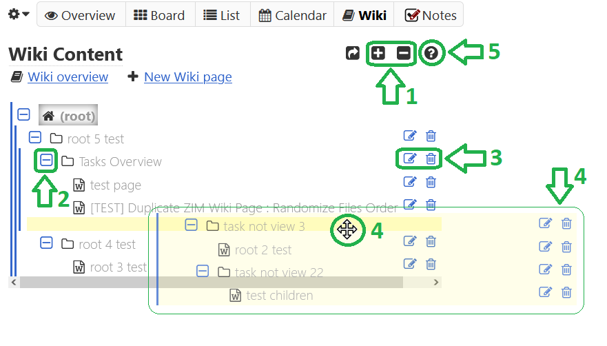

[<a href="#user-content-readme-bottom">&#8595; Bottom</a>] [<a href="#user-content-readme-top">&#8593; Top</a>]

<strong>Wiki Page New / Edit</strong>

Creating a new Wiki page always places it after the last page under the `(root)` node, then it can be moved anywhere in the Wiki tree hierarchy.

You only need to specify a title and fill in some content. The content is rich text enabled through MD, embedded markdown editing tools **[1]** are available. 

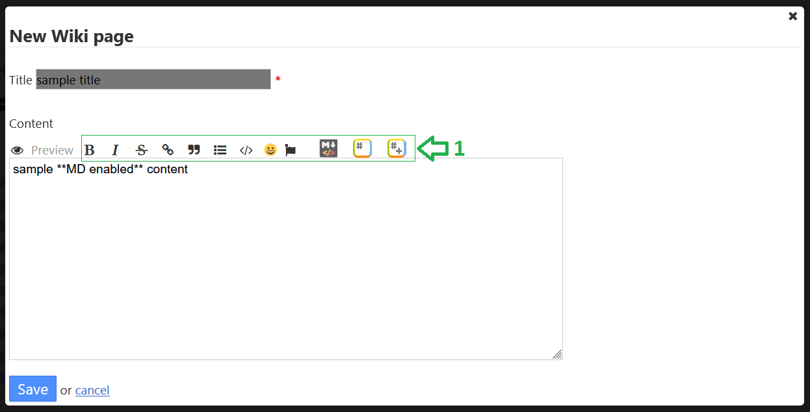

When editing an exising page there is an additional dropdown menu **[2]** which allows to change the parent page of the one currently being edited.
It will show a hierarchy tree of all the pages allowed for nesting.
For obvious reasons you cannot nest a page anywhere within its own branch, so all the pages under that branch will not be available in the dropdown. 

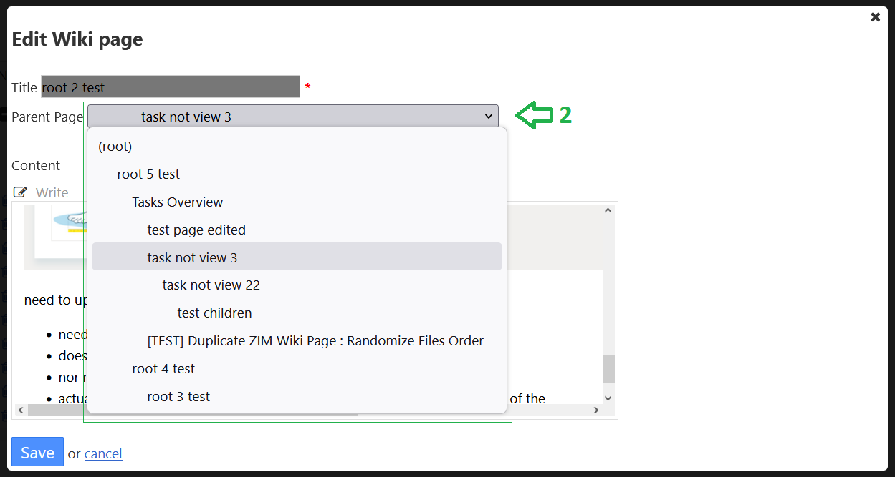

[<a href="#user-content-readme-bottom">&#8595; Bottom</a>] [<a href="#user-content-readme-top">&#8593; Top</a>]

<strong>Wiki Page Details</strong>

The detailed view of the selected page **[1]** shows its content as well as some additional information related to the page.
If you don't see a selected page **[1]** in the tree view on the left, then most probably you have collapsed some parent branches.
The `Go to Selected Wiki Page` arrow button **[2]** on top of the tree view will automatically expand all branches to the selected page in order to make it visible. 

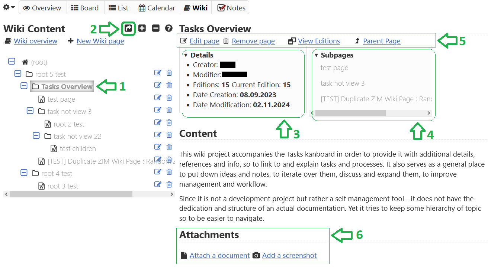

The elements of the detailed view besides its content are as follows:
* a collapsable section containing page attributes **[3]**, such as creation and modification dates and users, as well as editions info (see the _Wiki Page Editions_ section below)
* a collapsable section of links to direct subpages **[4]** which may be empty if the page has no nested children
* an action panel **[5]** right under  the title, which contains buttons for editing and removing the page, as well as viewing and managing the editions (see the _Wiki Page Editions_ section below)
* a bottom section for attachments **[6]** for viewing and managing images an files attached to this article (see the _Wiki Page Attachments_ section below)

[<a href="#user-content-readme-bottom">&#8595; Bottom</a>] [<a href="#user-content-readme-top">&#8593; Top</a>]

<strong>Wiki Page Attachments</strong>

At the bottom of a Wiki page there is a section that allows for adding, managing and viewing of attachments.
There are in general two types of attachments: images and all the others that are not directly viewable.

Images are considered all `*.gif, *.jpg, *.jpeg and *.png`, those are displayed with preview and can be browsed in a gallery.
All the other attachments are listed in a table below the image thumbnails.

A common way to add an image is **[1]** to make a screenshot (or copy a part of an image) to the clipboard and then paste it into the provided form.
This will create internally a **PNG** image **[1]** that will be attached to the page as if it was a normal file.
Clicking on any image thumbnail **[2]** will open a full preview of the image in the embedded article gallery.

An info tooltip **[3]** displays all the properties of the image which otherwise are displayed in the table below for the rest of the files.
The dropdown menu of every image **[4]** allows to `Download` or `Remove` the image as an attachment of the page.

Note the `Id` of the attachment **[5]**, be it image or any other file, if yo need to embed links within the article content later.

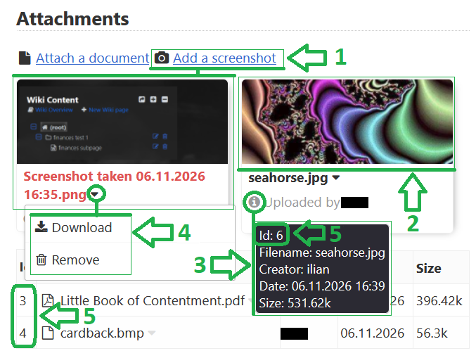

In order to attach a _document_ **[6]** there a form that allows for browsing or drag-and-dropping of practically _any type of file_.
All the attached files from the list **[6]** can be managed through their menu **[7]**, allowing `Download` and `Remove`. 
Some of them also have a `View file` option that will attempt to preview them in a separate browser window.
The later include all the `*.pdf, *.mp3, *.ogg, *.flac, *.wav, *.avi, *.webm, *.mov, *.m4v, *.mp4, *.svg` files.

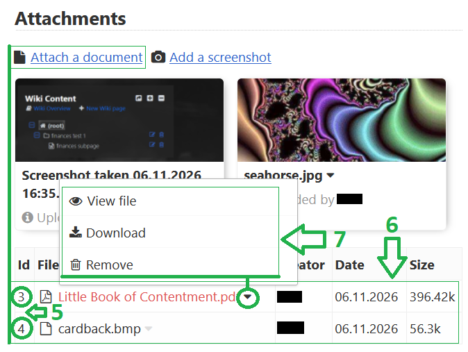

If you need to embed an image or a link in the article itself using markdown and the `Id` of an attachment **[5]** you can follow these examples:
* **[8]** embedding an image ``
* **[9]** adding a file data link `[file data link](/wiwi/file/<Id>/browser)`,
unfortunately this link **MUST** be opened in a standalone browser tab/window in order to work correctly and MD does not provide a way to do make such links
* **[10]** providing a file download link `[file download link](/wiki/file/<Id>/download)`

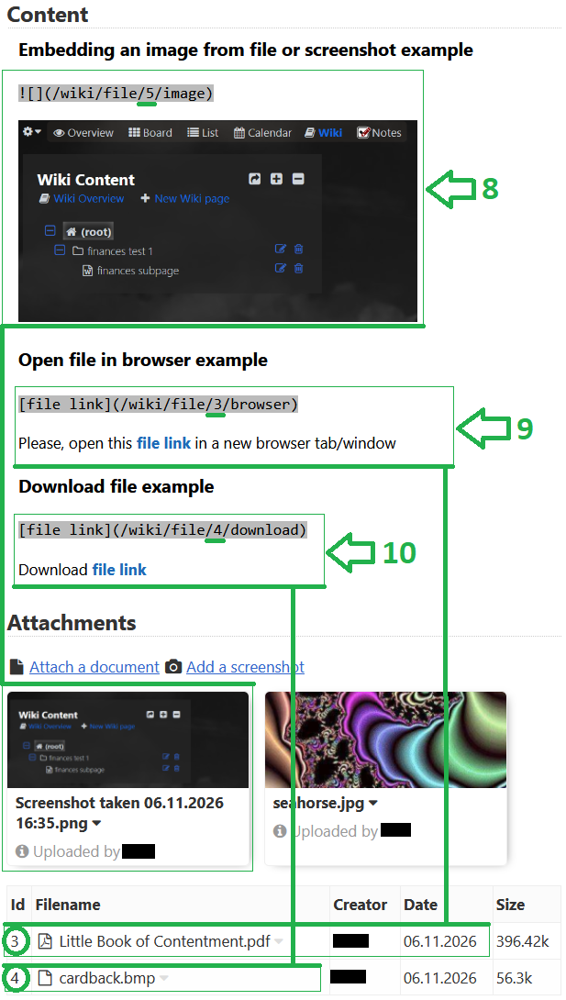

[<a href="#user-content-readme-bottom">&#8595; Bottom</a>] [<a href="#user-content-readme-top">&#8593; Top</a>]

<strong>Wiki Page Editions</strong>

The editions view allows for viewing and managing previous editions Wiki page that were automatically stored.
The global setting **Saving Editions** determines whether automatic saves of editions will take place when you make changes to the page (see the _Wiki Plugin Settings_ section below).

You can return back to the detailed view of the page **[1]** at any moment, or you can simply click on another page from the tree view.
On the editions list itself yo can observe and compare the detailed differences **[2]** in title, content and dates of the stored versions of the page.

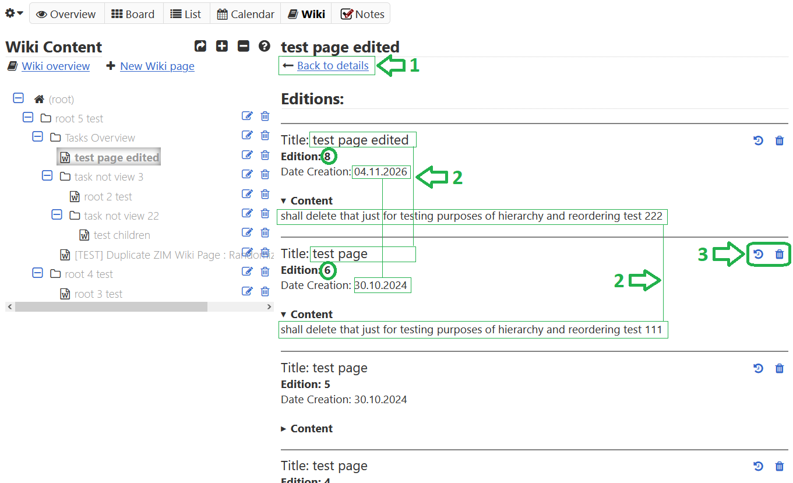

Some of the editions may be missing if they were deleted.
You can `Restore` or `Delete` an edition using the tool buttons **[3]** in the top right corner of each edition entry row.
* restoring an edition makes it currently active, thus allowing to switch back and forth between different version of the page
* you can only restore a version of the page that was previously saved as edition
* you can only delete a version of the page that is not currently active
* when you delete an edition it is permanently removed and can no longer be restored

[<a href="#user-content-readme-bottom">&#8595; Bottom</a>] [<a href="#user-content-readme-top">&#8593; Top</a>]

<strong>Wiki Plugin Settings</strong>

This section **[1]** is available from KB system menu: `Settings` &#10562; `Wiki settings`.
You need **ADMIN** priveleges to access it.

Enabling or disabling of the `Saving Editions` option **[2]** determines whether automatic saves of editions will take place when you make changes to the pages' title or content.
Reordering pages or reorganizing the hierarchy branches does **NOT** trigger creation of  new editions.

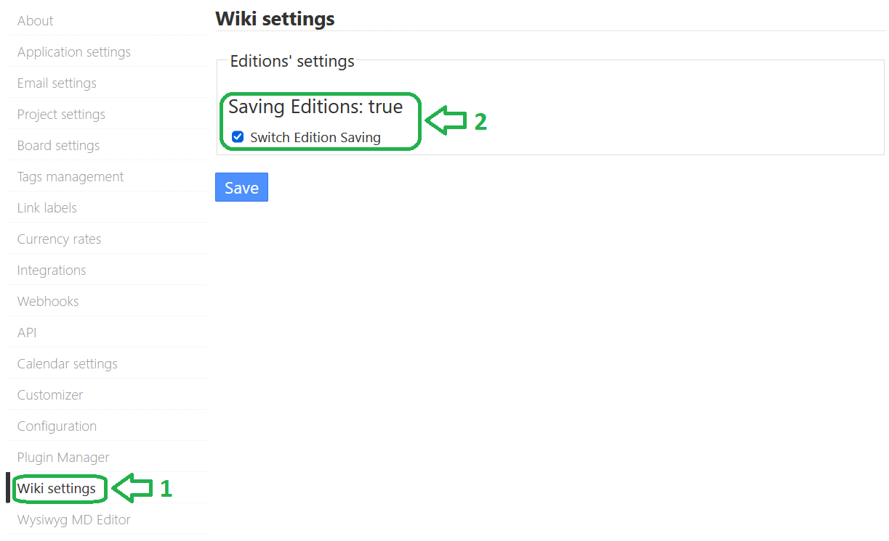

[<a href="#user-content-readme-bottom">&#8595; Bottom</a>] [<a href="#user-content-readme-top">&#8593; Top</a>]

[<a href="#user-content-readme-bottom">&#8595; Bottom</a>] [<a href="#user-content-readme-top">&#8593; Top</a>]

### 🔳 Wiki Overview

<strong>Wiki Overview Link</strong>

Go to the project menu **[1]** and select the `Wiki Overview` **[2]** from the dropdown. 

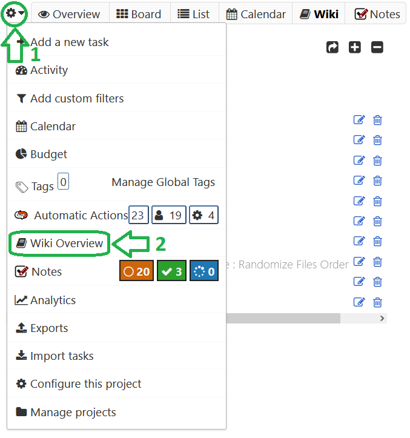

[<a href="#user-content-readme-bottom">&#8595; Bottom</a>] [<a href="#user-content-readme-top">&#8593; Top</a>]

<strong>Wiki Overview Table</strong>

The Wiki overview presents a fully expanded table view of the entire Wiki hierarchy, providing various details for each page.
Its purpose is rather informative than functional, yet you can still remove pages or add new ones, as well as edit existing pages (and reorder them via the edit form).

Clicking on a title link **[1]** in the overview table will redirect to the Wiki content for displaying the selected Wiki page.

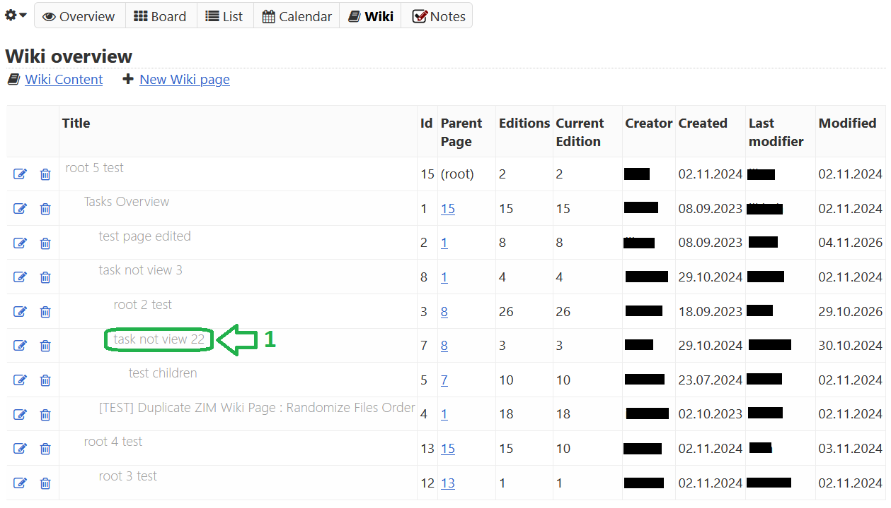

[<a href="#user-content-readme-bottom">&#8595; Bottom</a>] [<a href="#user-content-readme-top">&#8593; Top</a>]

[<a href="#user-content-readme-bottom">&#8595; Bottom</a>] [<a href="#user-content-readme-top">&#8593; Top</a>]

### 🔳 Search Wiki Pages

<strong>Search Wiki Pages Link</strong>

Since the functionality to search across Wiki pages is not project related it is available from the KB system menu **[1]**.
Select the `Wiki Pages` item **[2]** from the dropdown. 

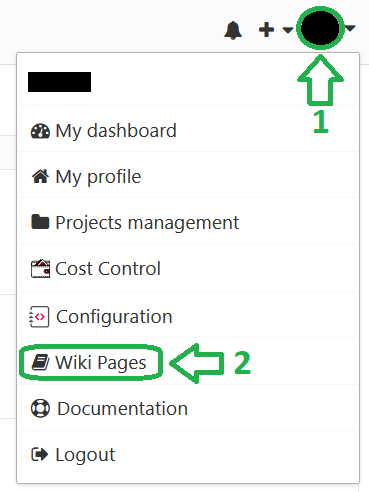

[<a href="#user-content-readme-bottom">&#8595; Bottom</a>] [<a href="#user-content-readme-top">&#8593; Top</a>]

<strong>Search Wiki Pages Results</strong>

This system view allows to search Wiki pages by title and content **[1]** across all the projects accessible by the user.
Additionally, some sorting **[2]** can be applied to the results after each search.
Repeated clicking of the sorting method switches between **ASC** and **DESC** order.

A preview of each page's content **[3]** is available within collapsable sections.

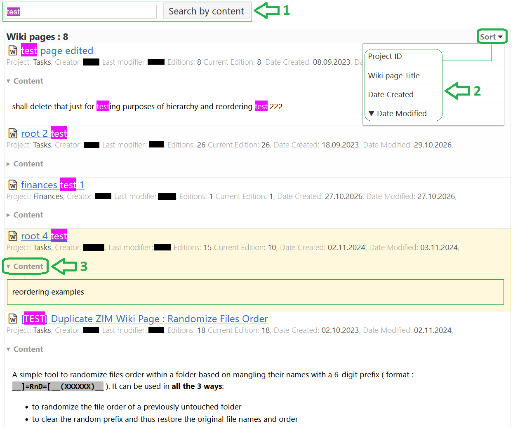

[<a href="#user-content-readme-bottom">&#8595; Bottom</a>] [<a href="#user-content-readme-top">&#8593; Top</a>]

[<a href="#user-content-readme-bottom">&#8595; Bottom</a>] [<a href="#user-content-readme-top">&#8593; Top</a>]

## Development

<strong>Roadmap</strong>

- [x] style updates
- [x] re/ordering and branching
- [x] [file attachment support](https://github.com/funktechno/kanboard-plugin-wiki/issues/3)
- [x] global wiki page search [issue 5](https://github.com/funktechno/kanboard-plugin-wiki/issues/5) prob next year
- [ ] rest support - LOW PRIORITY
- [ ] [issues/bugs](https://github.com/funktechno/kanboard-plugin-wiki/issues)

<strong>TODO</strong>

- [x] editions listing and restore
  - Related issues: [#9](https://github.com/kanboard/kanboard/issues/9)
- [x] finish edit
- [x] ordering
  - [x] drop down to switch
  - [x] drag to move, requires css magic
- [x] subpages and pagination
- [x] fix wiki sidebar
  - use html template render properly to list wiki pages
  - still having difficulty getting template helper working, manually added for each page
- [x] get rid of additional old budget plugin code
- [ ] kanboard rest api support - by request
- [ ] translations, maybe buttons, won't be translating "Wiki" for most languages
  - Related issues: [#13](https://github.com/kanboard/kanboard/issues/13), [#12](https://github.com/kanboard/kanboard/issues/12), [#10](https://github.com/kanboard/kanboard/issues/10)
- [ ] active, archived wikipages?
- [x] global wiki page search

[<a href="#user-content-readme-bottom">&#8595; Bottom</a>] [<a href="#user-content-readme-top">&#8593; Top</a>]

---

    
    
    
    
    
    
    

